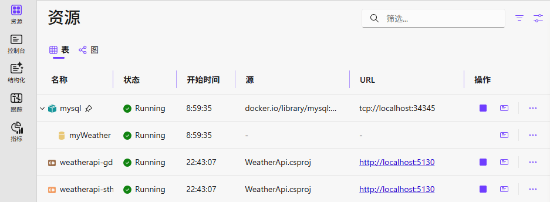
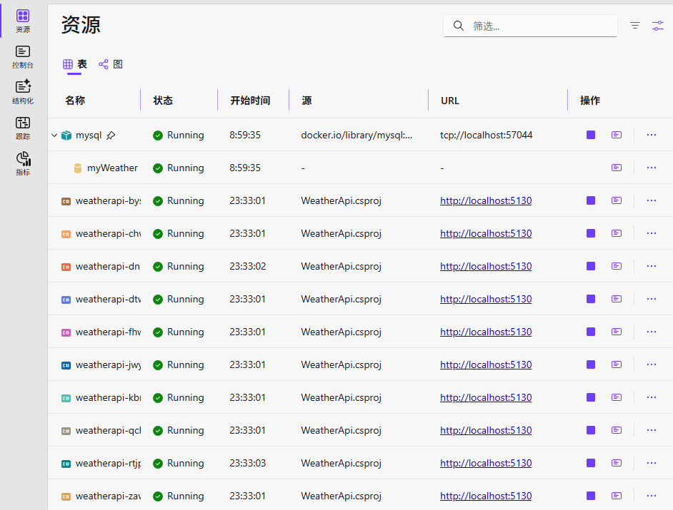

# Aspire+.NET10+手搓线程池打造抓不死的云应用
>* Aspire快速开发云应用
>* 压力测试Mysql被打挂
>* 手搓线程池打造打不死的云应用

## 一、手搓线程池支持.NET10
>* 最近.NET10正式版发布
>* 笔者每天打开VS2022和VSInstaller等推送升级
>* 等到今天也没等到
>* 就到微软官网查一下
>* 原来是要安装vs2026
>* 好吧装吧
>* 可伶笔者的C盘再次报红了
>* 手搓线程池项目也赶紧增加.NET10的支持
>* 在.NET10下把单元测试都跑通过了,就赶紧发nuget包了
>* 顺便做个项目演示一下手搓线程池打造抓不死的云应用

## 二、环境准备
>* 开启Windows的Hyper-V组件
>* 安装Docker Desktop
>* 下载Jmeter(用于压力测试,解压即可用)

## 三、Aspire快速开发云应用
### 1. 微软经典天气预报经典案例
>* 建一个WeatherApi的webapi项目
>* 按年月日获取当天的天气
>* IWeatherService用来读取和保存天气数据
>* 为了更真实我们用MySql数据库来存储

~~~csharp
public class WeatherForecastController(IWeatherService service, ILogger<WeatherForecastController> logger)
    : ControllerBase
{
    private readonly IWeatherService _service = service;
    private readonly ILogger<WeatherForecastController> _logger = logger;

    /// 

    /// 查看天气
    /// 

    [HttpGet("{year}/{month}/{day}")]
    public async Task<IActionResult> Get(int year, int month, int day, CancellationToken token = default)
    {
        WeatherForecast? weather;
        try
        {
            weather = await _service.GetWeather(year, month, day, token);
        }
        catch (Exception ex)
        {

            _logger.LogError(ex, "An error occurred while getting weather for {Year}/{Month}/{Day}", year, month, day);
            return BadRequest(ex.Message);
        }
        _logger.LogInformation("Get /{Year}/{Month}/{Day}", year, month, day);
        if (weather is null)
            return NotFound();
        return Ok(weather);
    }
}
public interface IWeatherService
{
    /// 

    /// 获取天气
    /// 

    /// <param name="date"></param>
    /// <param name="token"></param>
    /// <returns></returns>
    Task<WeatherForecast?> GetWeather(int year, int month, int day, CancellationToken token = default);
}
~~~

### 2. 用Dapper实现IWeatherService
>* Dapper的CommandDefinition可以封装CancellationToken
>* CancellationToken对及时取消数据库超时有作用

~~~csharp
public class WeatherService(DbDataSource dataSource)
    : IWeatherService
{
    private readonly DbDataSource _dataSource = dataSource;
    /// <inheritdoc />
    public async Task<WeatherForecast?> GetWeather(int year, int month, int day, CancellationToken token = default)
    {
        const string sql = """
                SELECT `Date`, `TemperatureC`, `Summary`
                FROM `weathers`
                WHERE `Date`=@date
                """;
        var date = new DateTime(year, month, day);
        var command = new CommandDefinition(sql, parameters: new { date }, cancellationToken: token);
        using var connection = _dataSource.CreateConnection();
        return await connection.QueryFirstOrDefaultAsync<WeatherForecast>(command);
    }
}
~~~

### 3. Aspire管理应用和数据库
>* nuget添加Aspire.Hosting.MySql
>* 添加mysql及myWeather数据库
>* 给myWeather数据库添加一个初始化sql脚本(myWeather.sql)
>* 添加WeatherApi项目并引用myWeather数据库
>* WithReplicas给WeatherApi项目配置了两个副本,避免单点故障

~~~csharp
var dbName = "myWeather";
var mysql = builder.AddMySql("mysql")
    .WithEnvironment("MYSQL_DATABASE", dbName)
    .WithLifetime(ContainerLifetime.Persistent);

var initScriptPath = Path.Join(Path.GetDirectoryName(typeof(Program).Assembly.Location), "./Data/myWeather.sql");
var db = mysql.AddDatabase(dbName)
    .WithCreationScript(File.ReadAllText(initScriptPath));

builder.AddProject<Projects.WeatherApi>("weatherapi")
    .WithReference(db)
    .WaitFor(db)
    .WithReplicas(2);
~~~

~~~sql
-- myWeather.sql
USE `myWeather`;
CREATE TABLE IF NOT EXISTS `weathers`
(
    `Date` Date NOT NULL,
    `Summary` varchar(255) NOT NULL,
    `TemperatureC` int NOT NULL,
    PRIMARY KEY (`Date`)
);
~~~

### 4. 配置WeatherApi项目
>* nuget引用Aspire.MySqlConnector
>* 用AddMySqlDataSource注册mysql数据库非常简便
>* 这么简单就完成了一个依赖mysql的云原生应用的开始

~~~csharp
var builder = WebApplication.CreateBuilder(args);
builder.AddServiceDefaults();
builder.AddMySqlDataSource("myWeather");
builder.Services.AddSingleton<IWeatherService, WeatherService>()
    .AddControllers();

var app = builder.Build();
app.MapDefaultEndpoints();
app.UseAuthorization();
app.MapControllers();
app.Run();
~~~

### 5. 测试更简单

#### 5.1 Aspire的dashboard
>* F5运行,直接打开Aspire的dashboard
>* 包含1个mysql及数据库myWeather
>* WeatherApi启动了2个进程
>* 控制台是用来查看日志的
>* 结构化也是用来查看格式化后的日志
>* 跟踪是APM的链路跟踪
>* 指标是查看应用性能的
>* Aspire开发云原生应用虽然简单,功能却特别全

#### 5.2 http测试
~~~http
GET {{WeatherApi_HostAddress}}/WeatherForecast/2025/11/12
Accept: application/json
~~~

~~~json
{
  "date": "2025-11-12T00:00:00",
  "temperatureC": 38,
  "temperatureF": 100,
  "summary": "Hot"
}
~~~

## 四、压力测试
### 1. Jmeter 500并发测试
>* GET http://localhost:5130/WeatherForecast/2025/11/11
>* 500并发
>* Throughput还行,平均每秒257
>* 平均耗时1.9秒
>* 10%的请求6.7秒以上
>* 5%的请求7.4秒以上
>* 1%的请求24.5秒以上
>* 还有29.6%的错误
>* 这样的结果肯定接受不了,第一反应就是要扩容

|Label|Samples|Average|Median|90% Line|95% Line|99% Line|Min|Max|Error %|Throughput|Received KB/sec|Sent KB/sec|
|:--|:--|:--|:--|:--|:--|:--|:--|:--|:--|:--|:--|:--|
|TOTAL|37000|1911|166|6794|7422|24505|1|30393|29.641%|257.90262|225.06|25.69|

### 2. 扩容到10个副本再测
#### 2.1 扩容到10个副本
>* Aspire扩容实在是太方便了
>* 把WithReplicas改成10就行
>* 扩容后WeatherApi启动了10个进程

#### 3.2 再次Jmeter 500并发测试
>* 通过率是240,与2副本差别并不大
>* 其他参数差别也不大
>* 最小耗时和最大耗时区别巨大
>* 应该是并发太高导致mysql处理不过来
>* 有人可能说用redis缓存就行了
>* 但如果每次请求的参数都不一样,缓存利用率低并发压力还是在数据库上
>* 这就好比挤公交,大家互不相让,谁也上不去啊
>* 好好地排队就行了
>* 手搓线程池擅长用队列控制并发

|Label|Samples|Average|Median|90% Line|95% Line|99% Line|Min|Max|Error %|Throughput|Received KB/sec|Sent KB/sec|
|:--|:--|:--|:--|:--|:--|:--|:--|:--|:--|:--|:--|:--|
|TOTAL|37552|1705|219|6227|6730|7838|0|26990|31.767%|262.21449|240.78|25.34|

## 五、用手搓线程池控制并发
### 1. 先对请求参数进行封装
>* 封装参数以便在队列中排队
>* 增加了一个expireTime字段,标记排队过期的请求
>* 并提供了一个GetWeather方法以便手搓线程池调用

~~~csharp
public class WeatherWarpper(int year, int month, int day, DateTime expireTime, CancellationToken token)
    : TaskCallBack<WeatherForecast?>, ITaskJobResult<WeatherForecast?>
{
    #region 配置
    private readonly int _year = year;
    private readonly int _month = month;
    private readonly int _day = day;
    private readonly DateTime _expireTime = expireTime;
    private readonly CancellationToken _token = token;

    /// <inheritdoc />
    public bool Status
        => !_token.IsCancellationRequested && _expireTime >= DateTime.Now;    
    #endregion
    /// 

    /// 获取天气
    /// 

    /// <param name="service"></param>
    /// <param name="token"></param>
    /// <returns></returns>
    public async Task GetWeather(IWeatherService service, CancellationToken token)
    {
        if (token.IsCancellationRequested || _token.IsCancellationRequested || _expireTime < DateTime.Now)
        {
            OnCancel();
            return;
        }
        var linked = CancellationTokenSource.CreateLinkedTokenSource(_token, token);
        var weather = await service.GetWeather(_year, _month, _day, linked.Token);
        OnSuccess(weather);
    }
}
~~~

### 2. 为天气服务定制处理器
>* 增加了一个expireTime字段,标记排队过期的请求
>* 实现IQueueProcessor接口以便手搓线程池调用
>* 实现IWeatherService以便替代原天气服务
>* GetWeather方法负责打包参数并加入队列,并不实际执行
>* 加入队列后,线程池自然会处理它

~~~csharp
public sealed class WeatherProcessor(IQueue<WeatherWarpper> queue, IWeatherService originalService, TimeSpan expireTime)
    : IQueueProcessor<WeatherWarpper>
    , IWeatherService
{
    #region 配置
    /// 

    /// 队列
    /// 

    private readonly IQueue<WeatherWarpper> _queue = queue;
    /// 

    /// 原始服务
    /// 

    private readonly IWeatherService _originalService = originalService;
    /// 

    /// 过期事件
    /// 

    private readonly TimeSpan _expireTime = expireTime;
    /// 

    /// 队列
    /// 

    public IQueue<WeatherWarpper> Queue
        => _queue;
    #endregion
    #region IWeatherService
    /// <inheritdoc />
    public Task<WeatherForecast?> GetWeather(int year, int month, int day, CancellationToken token)
    {
        var result = new WeatherWarpper(year, month, day, DateTime.Now.Add(_expireTime), token);
        if (token.IsCancellationRequested)
        {
            Cancel(result);     
        }
        else
        {
            _queue.Enqueue(result);
        }
        return result.Task;
    }
    /// <inheritdoc />
    Task<WeatherForecast> IWeatherService.CreateWeather(int year, int month, int day, CancellationToken token)
        => _originalService.CreateWeather(year, month, day, token);
    #endregion
    #region IQueueProcessor<WeatherResult>
    /// <inheritdoc />
    async void IQueueProcessor<WeatherWarpper>.Run(IQueue<WeatherWarpper> queue, ThreadJobService<WeatherWarpper> service, CancellationToken token)
    {
        while (queue.TryDequeue(out var item))
        {
            if (service.Activate(item))
            {
                try
                {
                    await item.GetWeather(_originalService, token);
                }
                catch (Exception ex)
                {
                    Exception(item, ex);
                }
            }
            else
            {
                Cancel(item);
                break;
            }
            if (token.IsCancellationRequested)
                break;
        }
        // 线程用完释放(回收)
        service.Dispose();
    }
    #endregion
    /// 

    /// 异常处理
    /// 

    /// <param name="callBack"></param>
    /// <param name="ex"></param>

    public static void Exception(IExceptionable callBack, Exception ex)
    {
        try
        {
            callBack.OnException(ex);
        }
        catch { }
    }
    /// 

    /// 取消
    /// 

    /// <param name="cancelable"></param>
    public static void Cancel(ICancelable cancelable)
    {
        try
        {
            cancelable.OnCancel();
        }
        catch { }
    }
}
~~~

### 3. 配置手搓线程池
>* 与原配置就是多了RegistProcessor
>* 为了与原始服务加以区分,服务键设置为SafeWeather
>* ConcurrencyLevel配置为32,2个副本也就是并发为64
>* ItemLife设置为3秒,这个设置比较宽松了
>* ItemLife不要设置太小,拦截的请求应该小于1%
>* expireTime设置为10秒,也是设置的比较宽松
>* expireTime也是不要设置太小,拦截的请求应该小于1%
>* 拦截太多影响用户体验,只要避免手搓线程池被堵塞就行
>* 现实项目可以多尝试几组参数,获取最优解

~~~csharp
var builder = WebApplication.CreateBuilder(args);

builder.AddServiceDefaults();

builder.AddMySqlDataSource("myWeather");

// Add services to the container.
const string weatherKey = "SafeWeather";
RegistProcessor(builder.Services, weatherKey, 32);
RegistServices(builder.Services);

var app = builder.Build();

app.MapDefaultEndpoints();

// Configure the HTTP request pipeline.

app.UseAuthorization();

app.MapControllers();
// 激活手搓线程池
_ = app.Services.GetRequiredKeyedService<ReduceJobService<WeatherWarpper>>(weatherKey);
app.Run();

static void RegistServices(IServiceCollection services)
{
    services.AddSingleton<IWeatherService, WeatherService>()
        .AddControllers();
}
/// 

/// 注册线程池
/// 

/// <param name="services"></param>
/// <param name="name"></param>
/// <param name="concurrency"></param>
/// <returns></returns>
static void RegistProcessor(IServiceCollection services, string name, uint concurrency)
{
    var options = new ReduceOptions { ConcurrencyLevel = concurrency, ItemLife = TimeSpan.FromSeconds(3), ReduceTime = TimeSpan.FromMilliseconds(1L) };
    var queue = new ConcurrentQueueAdapter<WeatherWarpper>();
    services.AddKeyedSingleton(name, (sp, key) => new WeatherProcessor(queue, sp.GetRequiredService<IWeatherService>(), TimeSpan.FromSeconds(10)))
        .AddKeyedSingleton(name, (sp, key) => options.CreateJob(queue, sp.GetRequiredKeyedService<WeatherProcessor>(key)));
    services.AddKeyedSingleton<IWeatherService>(name, (sp, key) => sp.GetRequiredKeyedService<WeatherProcessor>(key));
}
~~~

### 4. Controller几乎没区别
>* 只是增加FromKeyedServices用来调用线程池处理器

~~~csharp
public class SafeWeatherController([FromKeyedServices("SafeWeather")] IWeatherService service, ILogger<WeatherForecastController> logger)
    : ControllerBase
{
    private readonly IWeatherService _service = service;
    private readonly ILogger<WeatherForecastController> _logger = logger;

    /// 

    /// 查看天气
    /// 

    [HttpGet("{year}/{month}/{day}")]
    public async Task<IActionResult> Get(int year, int month, int day, CancellationToken token = default)
    {
        WeatherForecast? weather;
        try
        {
            weather = await _service.GetWeather(year, month, day, token);
        }
        catch (Exception ex)
        {

            _logger.LogError(ex, "An error occurred while getting weather for {Year}/{Month}/{Day}", year, month, day);
            return BadRequest(ex.Message);
        }
        _logger.LogInformation("SafeWeather /{Year}/{Month}/{Day}", year, month, day);
        if (weather is null)
            return NotFound();
        return Ok(weather);
    }
}
~~~

### 5. 压力测试
>* 启动2个副本
>* 500并发
>* 没有错误
>* 平均0.22秒
>* 10%的请求0.28秒以上
>* 5%的请求0.31秒以上
>* 1%的请求0.45秒以上
>* 手搓线程池的效果是不是挺不错的
>* 不需要增加缓存也能扛得住高并发

|Label|Samples|Average|Median|90% Line|95% Line|99% Line|Min|Max|Error %|Throughput|Received KB/sec|Sent KB/sec|
|:--|:--|:--|:--|:--|:--|:--|:--|:--|:--|:--|:--|:--|
|TOTAL|50000|224|233|284|317|457|3|602|0.000%|2075.11932|490.41|285.73|

## 六. 话说防抓取
### 1. 取消超时请求
>* 某些只读场景突发高并发
>* 不拦截就会拖垮应用
>* 是不得不拦截一部分请求
>* 这时可以从前端传个请求时间过来
>* 太高并发Web服务器也是要排队的
>* 部分请求到Action响应时就可以考虑直接取消了
>* 把前端请求时间叠加到超时时间参数里面
>* 以便及时取消超时请求

### 2. 中间件处理
>* ConcurrencyLimiter等并发控制中间件也是选项

好了,就介绍到这里,更多信息请查看源码库
源码托管地址: https://github.com/donetsoftwork/ConcurrentDemo ，欢迎大家直接查看源码。
gitee同步更新:https://gitee.com/donetsoftwork/ConcurrentDemo

如果大家喜欢请动动您发财的小手手帮忙点一下Star,谢谢！！！